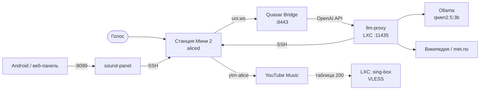

# AliceStation

> Своя Алиса на Яндекс Станции Мини 2: локальная языковая модель вместо облака, музыка с YouTube Music, собственная панель управления и Android-приложение.


---

## Что это

Проект превращает Яндекс Станцию Мини 2 в управляемую станцию «для себя»:

- голосовые ответы даёт **локальная модель** (Ollama, `qwen2.5:3b`), а не облако;
- музыка играет из **YouTube Music** через `ytm-alice` и VPN-туннель;
- всем можно управлять из **своей панели** и **Android-приложения**: плеер, эквалайзер, Bluetooth, будильник;
- подсветка кольца показывает состояние: поиск, загрузка, ответ, «огонь» под музыку.

Собрано и проверено на реальной станции (`yandexmini_2`, Buildroot, aarch64, 238 МБ RAM).

---

## Возможности

| | Возможность |
|---|---|
| 🗣 | Ответы от локальной модели, без облака |
| 🎵 | YouTube Music без подписки Яндекса (через свой VPN) |
| 🔎 | Поиск и запуск по ID — не ломается на падежах и латинице |
| 🎧 | Умные рекомендации: сид из истории прослушиваний, лайков, избранного |
| 🌙 | Радио по настроению: «включи что-нибудь спокойное» |
| ❤️ | Избранное голосом и кнопкой, очередь с переходом по тапу |
| ⏰ | Будильник станции: включает музыку в заданное время |
| 📊 | Эквалайзер: 5 полос, реальная кривая в прошивке |
| 🔊 | Bluetooth-вывод на внешний усилитель |
| 💡 | Подсветка: зелёное дыхание, синяя загрузка, фиолетовый ответ, огонь |
| 🧠 | Факты — из Википедии, если модель не уверена |
| 🛡 | Сторож видео: пропускает YouTube-видео вместо песни |

---

## Архитектура



**Как это работает.** Станция ходит в облако по WebSocket `uni.ws`. Quasar Bridge слушает этот поток и подменяет ответы: часть запросов уходит в локальный `llm-proxy`, который отвечает сам (команды, погода, музыка) или переспрашивает Ollama. Музыка идёт мимо облака — `ytm-alice` тянет YouTube Music, а трафик Google заворачивается в VPN на LXC.

---

## Состав репозитория

```
AliceStation/
├─ station/                скрипты для самой колонки
│  ├─ led.sh               подсветка: green | blue | violet | off
│  ├─ ledp/                LED-паттерны (дыхание, бегущая загрузка, фиолетовый)
│  ├─ ytm-led.sh           эффект «огонь» во время музыки
│  ├─ audio-out.sh         вывод звука: bt | spk
│  ├─ audio-watch.sh       автопереключение при подключении Bluetooth
│  ├─ bt.sh                поиск и сопряжение Bluetooth-устройств
│  ├─ alarm-daemon.sh      будильник станции
│  ├─ asound.bt/.internal  варианты /etc/asound.conf
│  ├─ ytm-routes.sh        маршруты Google в таблицу 200
│  ├─ ytm-routes-watch.sh  сторож маршрутов
│  ├─ eqcfg.py             разбор user_config.dat (эквалайзер)
│  └─ init.d/              автозапуски S97/S98
├─ lxc/
│  ├─ llm-proxy.py         прокси перед Ollama
│  ├─ sound-panel/         API и веб-интерфейс панели
│  ├─ bridge/config.json   конфиг Quasar Bridge
│  └─ singbox-config.example.json
├─ android/                исходники и APK (сборка без Gradle)
└─ tools/                  ssh-хелперы для станции и LXC
```

> Бинарники Quasar Bridge и `ytm-alice` **не входят** в репозиторий — они ставятся отдельно (см. ниже).

---

## Требования

- Яндекс Станция Мини 2 с root-доступом по SSH (dropbear, порт 2222);
- LXC или мини-ПК на Debian/Ubuntu с root и интернетом;
- [Ollama](https://ollama.com) с моделью `qwen2.5:3b` (хватит CPU);
- VLESS-сервер для YouTube Music (или другой VPN);
- для сборки APK: JDK 17 + Android SDK build-tools 34.

Все IP в примерах — заглушки. Замените на свои.

---

## Быстрый старт

### 1. Станция

```bash
# Quasar Bridge (бинарники ставятся отдельно)
cd /data && tar xzf qb-pkg.tar.gz -C /data/opt/quasar-bridge
sh /data/opt/quasar-bridge/install.sh
cp config.json /data/opt/quasar-bridge/config.json
sh /data/opt/quasar-bridge/app/control.sh restart
sh /data/opt/quasar-bridge/app/control.sh check-backends   # ждём "LLM: ok"

# YouTube Music
/data/yam/bin/yam install /data/ytm-alice.yampkg
ytm-alice daemon start

# музыка не должна уходить в облако Яндекса
cat >> /etc/hosts <<'EOF'
127.0.0.1 api.music.yandex.net
127.0.0.1 music.yandex.ru
127.0.0.1 quasar.yandex.net
EOF

# скрипты
cp station/*.sh /data/ && chmod +x /data/*.sh
cp -r station/ledp /data/ && cp station/init.d/* /etc/init.d/
sh /data/ytm-routes.sh
```

### 2. LXC

```bash
apt install -y sing-box nftables
cp lxc/singbox-config.example.json /etc/sing-box/config.json   # вписать свой сервер
systemctl enable --now sing-box

mkdir -p /opt/llm-proxy /opt/sound-panel
cp lxc/llm-proxy.py /opt/llm-proxy/proxy.py
cp lxc/sound-panel/* /opt/sound-panel/
ssh-keygen -t ed25519 -f /root/.ssh/station -N ''
ssh-copy-id -p 2222 -i /root/.ssh/station root@<station-ip>

systemctl enable --now llm-proxy sound-panel
```

Панель поднимется на `http://<lxc-ip>:8099`.

### 3. Приложение

```bash
adb install -r android/AliceHome.apk
```

Долгий тап по экрану — смена адреса панели. Виджет: рабочий стол → «Виджеты» → «Алиса Дом».

---

## Голосовые команды

| Фраза | Действие |
|---|---|
| «включи Мияги» | поиск и запуск трека |
| «плей», «играй» | рекомендации |
| «включи что-нибудь спокойное» | радио по настроению |
| «добавь в избранное» | в избранное |
| «включи избранное» | играет сохранённое |
| «дальше», «назад», «переключи трек» | навигация по очереди |
| «что играет» | называет трек |
| «переключи на колонку / на блютуз» | выбор вывода звука |
| «какая погода» | met.no |
| «кто такой Циолковский» | Википедия |

---

## API панели

| Метод | Путь | Назначение |
|---|---|---|
| GET | `/api/state` | состояние плеера, звука, эквалайзера |
| GET | `/api/queue` | очередь |
| GET/POST | `/api/favorites` | избранное (`add_current`, `remove`, `play`) |
| GET/POST | `/api/alarms` | будильники |
| GET | `/api/history` | история прослушиваний |
| GET | `/api/mixseed` | исполнитель-сид для рекомендаций |
| GET | `/api/bt` | Bluetooth-устройства и вывод звука |
| GET | `/api/sys` | CPU, память, температура, диск |
| POST | `/api/player` | play/pause/next/previous/seek |

---

## Настройка

- `lxc/bridge/config.json` — правила маршрутизации: что уходит в облако, что в локальную модель.
- `lxc/bridge/runtime.env` — адрес `llm-proxy` и модель.
- `station/ledp/*.led` — LED-паттерны: `loop`, затем строки `<rrggbb> ×6 <длительность>`.
- `station/alarms.txt` (на станции) — будильники: `минуты_от_полуночи|смещение_UTC|запрос`.

Перезапуск после правок:

```bash
sh /data/opt/quasar-bridge/app/control.sh restart
systemctl restart llm-proxy sound-panel
```

---

## Ограничения

- **Звонки, режим охраны, сценарии, подписка** — облачные функции Яндекса, локального API нет.
- **Лайки в аккаунт** не ставятся: `ytm-alice` логинится по TV-токену без cookies, поэтому «избранное» локальное.
- **Bluetooth-ключи** не сохраняются после перезагрузки (хранилище BlueZ на read-only разделе).
- **Скорость**: старт трека ~12 с (VPN), ответ модели 2–6 с.
- **Память** станции: 238 МБ, свободно 50–80 МБ.
- **LED-движок** залипает, если убивать чужие процессы `led_util` — лечится перезагрузкой.

---

## Дисклеймер

Проект **не обходит платную подписку и не ломает DRM**: музыка играет из вашего собственного аккаунта YouTube Music, локальная модель работает на вашем железе.

Вы сами отвечаете за соблюдение условий использования сервисов Яндекса, YouTube и законодательства своей страны. Проект не связан с Яндексом; все товарные знаки принадлежат их владельцам.

Используйте на своём оборудовании и на свой риск: вмешательство в прошивку может привести к потере гарантии.

---

## Планы

- [ ] Громкость и таймер сна в приложении
- [ ] Мои плейлисты YouTube Music
- [ ] Telegram-бот и алерты о падении туннеля
- [ ] Настоящие лайки через cookies-сессию
- [ ] Резервное копирование конфигов

---

## Лицензия

[MIT](LICENSE)
